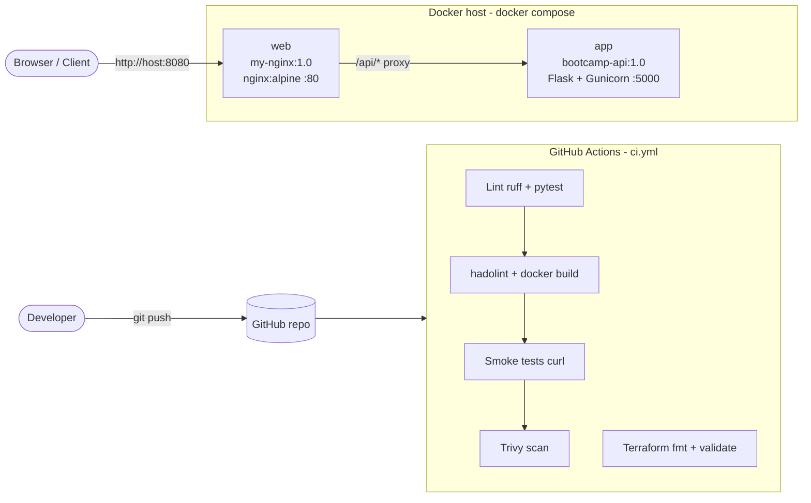

# Containerised App with CI/CD Pipeline

> DevOps Bootcamp app (Flask) containerised behind Nginx, with a GitHub Actions pipeline.


A small, production-style reference project: an **Nginx** web server and a **Flask API**, each in its own Docker container, wired together with **Docker Compose** and tested on every push by a **GitHub Actions** pipeline.

## The business problem

Many small teams still deploy by copying files onto a single server by hand. Releases are slow, "it works on my machine" bugs slip through, and nobody can rebuild the server if it dies.

This project shows the fix I deliver for clients:

| Before | After |
|---|---|
| App installed directly on a VPS | App and web server run in versioned Docker images |
| Manual, undocumented deploys | One command: `docker compose up -d --build` |
| Bugs found in production | Every push is linted, unit-tested, built and smoke-tested automatically |
| Unknown image vulnerabilities | Trivy scans both images for HIGH/CRITICAL CVEs |
| Server built by hand | Optional Terraform rebuilds the server on AWS free tier |

## Architecture



- `/` is served by Nginx from the static `index.html` (custom 404 page included).
- `/api/` is reverse-proxied by Nginx to the Flask container over the private Compose network. The API port is never published to the host.

## Tech stack

| Layer | Tool |
|---|---|
| Web server | Nginx (`nginx:alpine`) |
| API | Python 3.12, Flask, Gunicorn |
| Containers | Docker, Docker Compose |
| CI/CD | GitHub Actions |
| Quality and security | ruff, pytest, hadolint, Trivy |
| Infrastructure as Code (optional) | Terraform, AWS EC2 free tier |

## Repository layout

```
.
├── nginx-web/            # Task C1 - custom Nginx image
│   ├── Dockerfile
│   ├── index.html
│   ├── 404.html
│   ├── nginx.conf        # standalone config (custom 404)
│   └── proxy.conf        # compose config (adds /api reverse proxy)
├── app/main.py           # Flask API (/ and /health)
├── tests/test_app.py     # pytest unit tests
├── requirements.txt
├── Dockerfile            # API image
├── docker-compose.yml
├── .github/workflows/ci.yml
├── terraform/            # optional: provision on AWS free tier
├── scripts/evidence.sh   # runs Task C1 and prints the evidence
└── docs/pipeline.png     # screenshot of a green pipeline run
```

## Quick start (under 5 minutes)

Prerequisites: Docker Desktop (or Docker Engine with the Compose plugin) and Git.

```bash
git clone https://github.com/usama1git/DevOps_Multinet.git
cd DevOps_Multinet
```

### Option 1 - Run only the Nginx container (Task C1)

```bash
cd nginx-web
docker build -t my-nginx:1.0 .
docker run -d --name web -p 8080:80 my-nginx:1.0
curl http://localhost:8080          # -> "Hello from Nginx in Docker!"
docker ps                           # STATUS shows (healthy) after a few seconds
docker logs web
docker stop web && docker rm web
```

Or run everything above in one go and print the evidence: `bash scripts/evidence.sh` (Windows: `powershell -ExecutionPolicy Bypass -File scripts\evidence.ps1`).

**Live editing without rebuilding (bind mount):**

```bash
docker run -d --name web-dev -p 8081:80 \
  -v "$(pwd)/index.html:/usr/share/nginx/html/index.html:ro" my-nginx:1.0
```

### Option 2 - Run the full stack (Nginx + Flask API)

```bash
docker compose up -d --build
curl http://localhost:8080/            # static page from Nginx
curl http://localhost:8080/api/        # Hello from DevOps Bootcamp v2
curl http://localhost:8080/api/health  # ok
docker compose down
```

### Run the tests locally

```bash
python3 -m venv .venv && source .venv/bin/activate
pip install -r requirements.txt ruff
ruff check . && pytest -v
```

## CI/CD pipeline

The workflow in `.github/workflows/ci.yml` runs on every push and pull request to `main`:

1. **Lint and unit tests** - `ruff` and `pytest` on the Flask API.
2. **Build and smoke test** - `hadolint` on both Dockerfiles, builds `my-nginx:1.0`, checks the page and the custom 404, then starts the full Compose stack and checks `/` and `/api/health` through Nginx.
3. **Security scan** - Trivy reports HIGH/CRITICAL vulnerabilities in both images.
4. **Terraform** - `fmt -check` and `validate`.


## Optional: deploy to AWS free tier with Terraform

```bash
cd terraform
cp terraform.tfvars.example terraform.tfvars   # set repo_url
terraform init && terraform apply
# open the "url" output after 2-3 minutes; remove everything with: terraform destroy
```

AWS credentials are read from your local AWS CLI profile. They are never stored in this repository.

## Security notes

- No secrets are committed; `.env`, `*.tfvars` and Terraform state are ignored by Git.
- The API container runs as a non-root user and is reachable only through Nginx.
- Both images define a `HEALTHCHECK`, so Docker and Compose know when they are actually ready.

## Author

**Usama Bashir** - DevOps and Cloud Engineer (CCNP, JNCIS-ENT)
Available for Docker, CI/CD and cloud automation work.

## License

[MIT](LICENSE)
